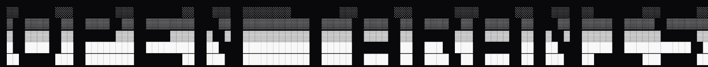
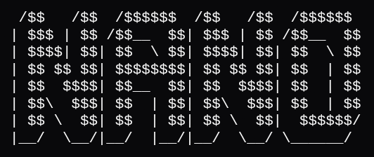

  <strong>SyntaxError4Life</strong> 
  Développeur • Data Scientist • Étudiant

  
  
  

 

<table width="100%">
  <tr>
    <td width="50%" valign="top">
      
    </td>
    <td width="50%" valign="top">

<h3>📊 GitHub Stats</h3>

  

  

  </tr>
</table>

 

<!-- Projet 1 : open-taranis -->
<table width="100%" bgcolor="#000000">
  <tr>
    <td>
      
       
      
    </td>
  </tr>
</table>

 

<!-- Projet 2 : nano -->
<table width="100%" bgcolor="#000000">
  <tr>
    <td>
      
       
      
    </td>
  </tr>
</table>

 

  

